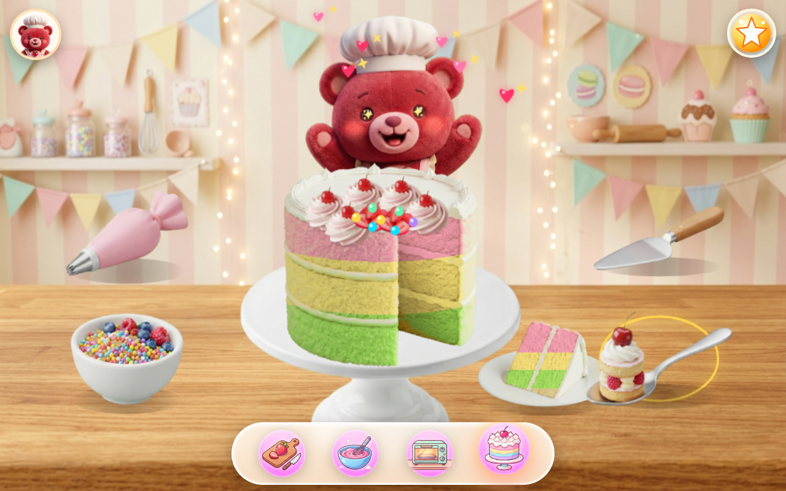

# 🌈🎂 Critter Rainbow Kitchen — Studio 3D Toy Patisserie Simulator

- **在线畅玩 (GitHub Pages Live)**: [https://kunruiw1991.github.io/critters-kitchen/](https://kunruiw1991.github.io/critters-kitchen/)
- **代码仓库 (GitHub Repository)**: [https://github.com/kunruiw1991/critters-kitchen](https://github.com/kunruiw1991/critters-kitchen)

---

## ✨ 专为 6 岁不识字小朋友设计的 3D 玩具甜品厨房 (Zero-Text Studio 3D Toy Patisserie)

彻底告别生硬丑陋的代码几何绘图（`ctx.arc` / `bezierCurveTo`），全流程采用 **45 张高精度 3D 玩具级烘焙工坊渲染资产（Studio-Rendered 3D Toy Patisserie Assets）** + **像素级 3D 海绵蛋糕染色着色器（Cylindrical 3D Sponge Cake Shader）**，遵循 **100% 零文字、零语音解说（`alphaHanziCount === 0`）** 与 **极简大按钮触控交互（全屏仅 $\le 6$ 个 $\ge 80\text{px}$ 圆润图标按钮）**：

| 阶段 | 核心手势与 3D 玩具互动 | 视觉因果与纯 WebAudio ASMR 音效 |
| :--- | :--- | :--- |
| **Stage 1: 🍓 鲜果可可切切乐** *(3D Fruit & Cocoa Chop)* | 点击上方 6 只骨瓷碗选食材（🍓草莓、🍌香蕉、🥝奇异果、🫐蓝莓、🍑水蜜桃、🍫可可豆），手指滑动或点击木质砧板用 3D 主厨刀连切 3 刀 | 整颗立体水果/可可果直接摆在橡木砧板上，刀刃划过泛起星光刀痕与清脆木砧板 ASMR 切菜声（`playChop`），露出饱满逼真的水果横截面并飞入骨瓷碗中。 |
| **Stage 2: 🥣 骨瓷碗打蛋与漩涡面糊** *(Porcelain Bowl Batter Mix)* | 点击左侧鸡蛋盘敲入黄金蛋黄、点击右侧牛奶壶倾倒鲜奶，顺时针画圈或点击 3D 珊瑚粉打蛋器搅拌 | 食材色彩真实融入奶油面糊并随打蛋器旋转拉出丝滑双色大理石纹，伴随清脆磕蛋声、倒奶水声与粘稠面糊呼啦声（`playWhisk`）。 |
| **Stage 3: 🧁 薄荷绿复古烤箱烘焙** *(Pastel Mint Mini-Oven Bake)* | 点击薄荷绿复古小烤箱，透过暖光透明视窗观察三层海绵蛋糕长高膨胀 | 烤箱内亮起温暖琥珀色灯光，三层定制色彩的松软海绵夹心蛋糕在视窗内缓缓膨胀长高，伴随烘烤暖风声与清脆的出炉“叮！”铃声（`playOvenDing`）。 |
| **Stage 4: 🎂 裱花装饰、切块装盘与投喂庆典** *(3D Decorating, Slicing & Feeding)* | 自由点击/拖拽 **裱花袋**（挤出 3D 奶油樱桃玫瑰花）、**糖果碗**（撒落立体鲜果与彩色糖珠）、**蛋糕刀**（切下一角装入侧边骨瓷小盘）、**小金勺**（舀起蛋糕喂给小动物主厨） | 进入 Stage 4 时呈现未装饰的纯净三层海绵蛋糕，完全由小朋友亲手挤奶油花、撒糖珠、切块装盘并一口口喂给 **Bobby BearHug / CatNap / DogDay**，触发满屏爱心彩带与八音盒庆典旋律（`playVictory`）！ |
